# srs

Spaced-repetition drills that interrupt you on purpose. Every few hours of the
work week, at random, a small Ghostty window opens and quizzes you on **one**
module that has cards due — never all of them at once. It holds off while a
Focus is on, while you are away or locked, and while a quiz is already open.

```
◈ 5d ·3        streak of 5 days, extended today; 3 cards due
```

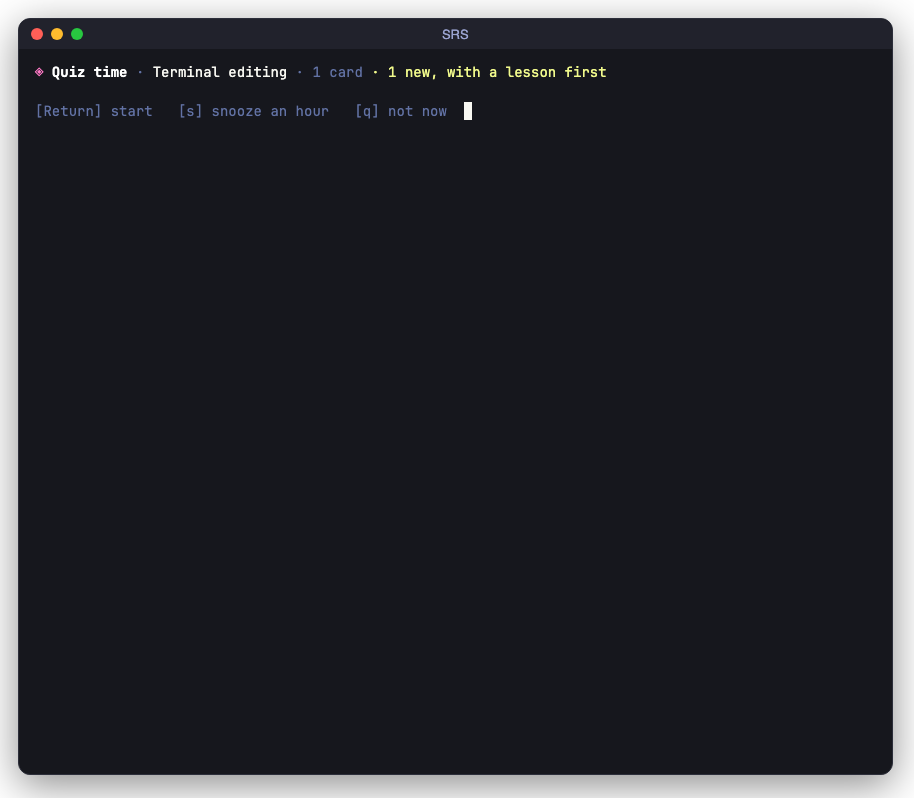

<sub>The terminal images are real sessions, regenerated by
[`docs/make-media.py`](docs/make-media.py); the menu is a screenshot.</sub>

## Modules

**Terminal editing** — drilled in real zsh (`vared`, your shell's own emacs
keymap), so what you practise is exactly what your prompt does. Each card loads
a line with the cursor somewhere, gives you the target, and grades the text you
end up with *and* how many keystrokes it took. Retyping the line gets the text
right and blows par.

| Card | Par route |
|------|-----------|
| Kill to end of line | `^K` |
| Scrap the line | `^U`, type |
| Stash and restore | `^U`, type the other command, `⏎`, then `^Y` |
| Move the tail to the front | `^K ^A ^Y ␠` |
| Yank twice | `^K ^Y ␠ ^Y`, suffix |

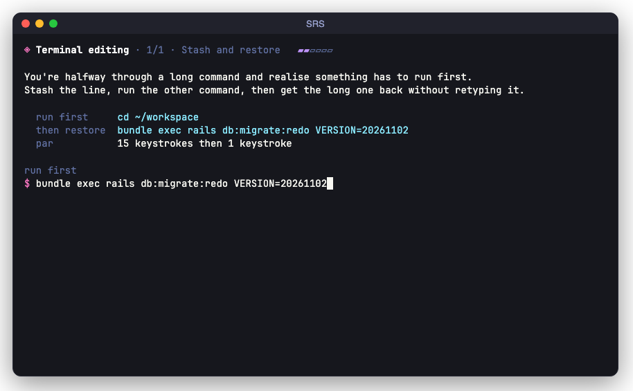

In zsh `^U` is `kill-whole-line` — it wipes the line wherever the cursor is —
not readline's "delete to the start of the line". The cards teach zsh's.
`^Y` yanks only the most recent kill; zsh doesn't merge two kills in a row.

**Lateral joins** — SQLite has no `LATERAL` (a syntax error even in 3.51), so
these run on [DuckDB](https://duckdb.org). Each card is a small database and the
exact output to produce from it; you write the query in `$EDITOR` (vim if
unset), save and quit, and it is run and compared row for row, in order.

| Card | What it drills |
|------|----------------|
| Top N per group | `ORDER BY … LIMIT n` per outer row; `CROSS` vs `LEFT … ON true` |
| Latest row, whole | the row behind a `max()`, not `max()` of each column |
| As-of lookup | the rate in effect on each event's date (`<=`, nothing before it) |
| Expand ranges | `generate_series` per row, inclusive, backwards ranges |
| Looking back | per-row aggregates over earlier rows; count 0, max NULL |
| Name it once | chained laterals that define a value once and reuse it |

Every scenario is generated fresh: entity names, sizes, directions, keep-or-drop
rules and sort orders vary, rows are listed shuffled, and each one has
confounding rows (a parent with nothing to join, an event before any price, a
row exactly on the threshold). Before a scenario is shown, the common wrong
answers are run against it; if any of them would happen to produce the right
output, the scenario is regenerated. A correct query without the `LATERAL`
keyword is sent back — DuckDB lets a subquery see earlier tables without it,
Postgres doesn't.

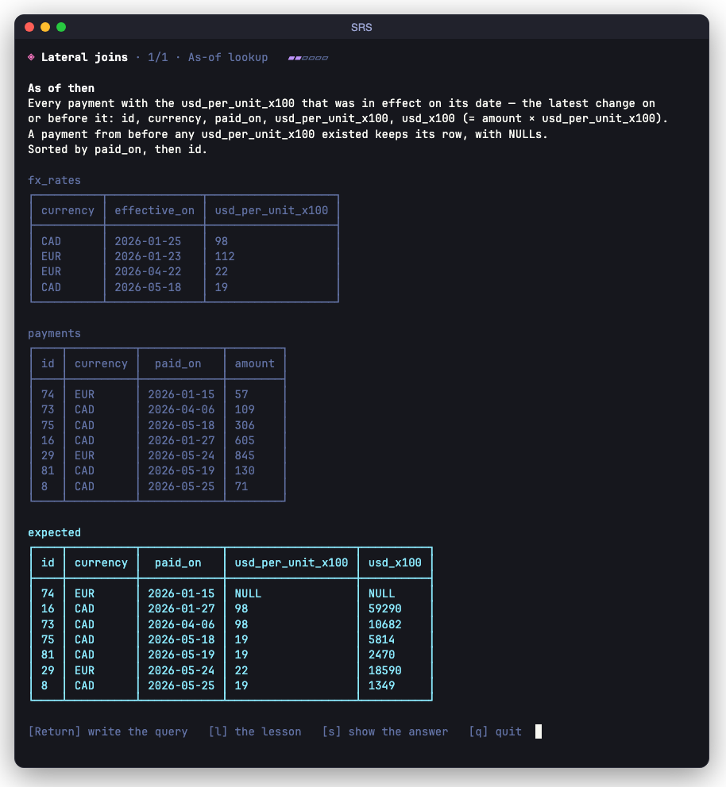

| The card | A wrong attempt, diagnosed | Solved |
|---|---|---|
| 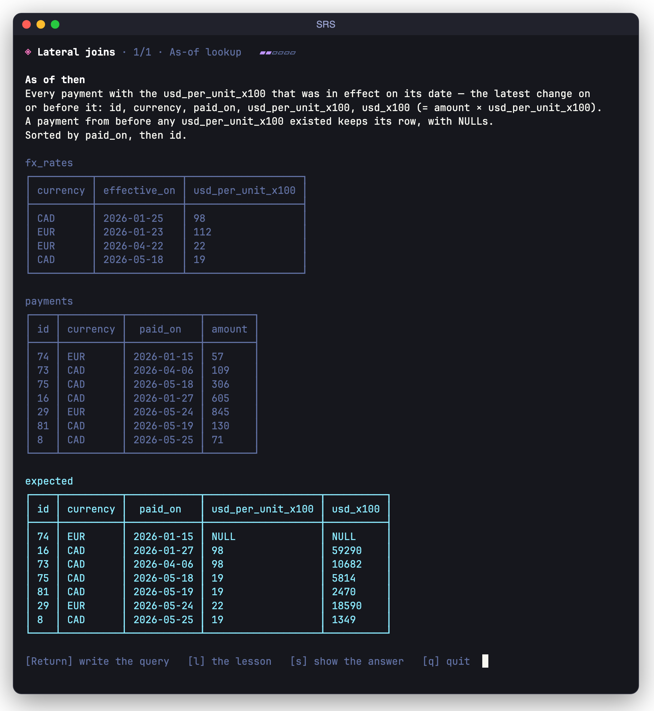 | 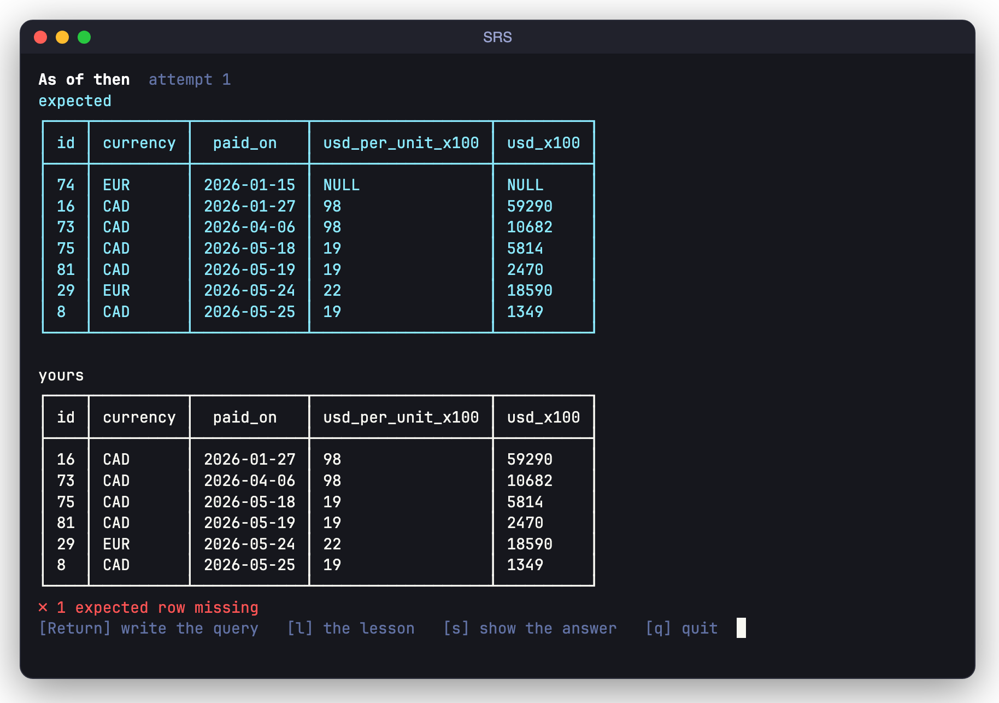 | 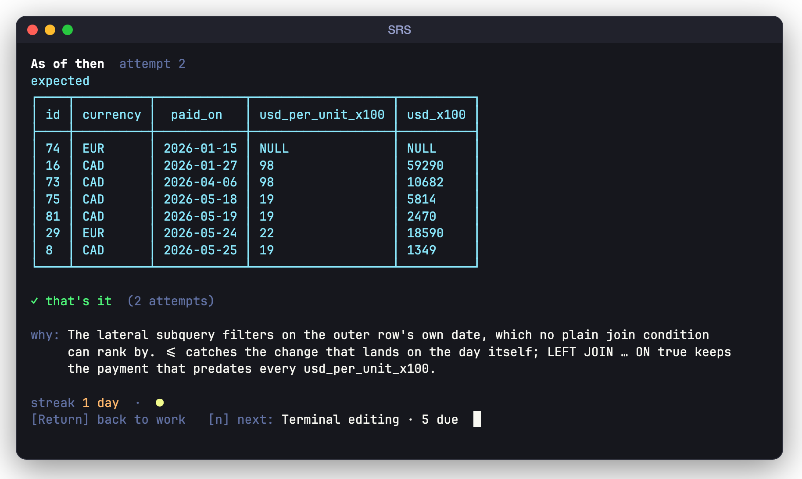 |

## Teach, rehearse, quiz

Nothing is asked before it has been taught. The first time a module comes up
you get its **primer** — for terminal editing, what the line editor is, moving
the cursor, killing versus deleting, the kill buffer, and where zsh and bash
differ; for lateral joins, what `LATERAL` means, `CROSS` versus `LEFT … ON
true`, and which databases have it.

| Terminal editing primer | Lateral joins primer |
|---|---|
| 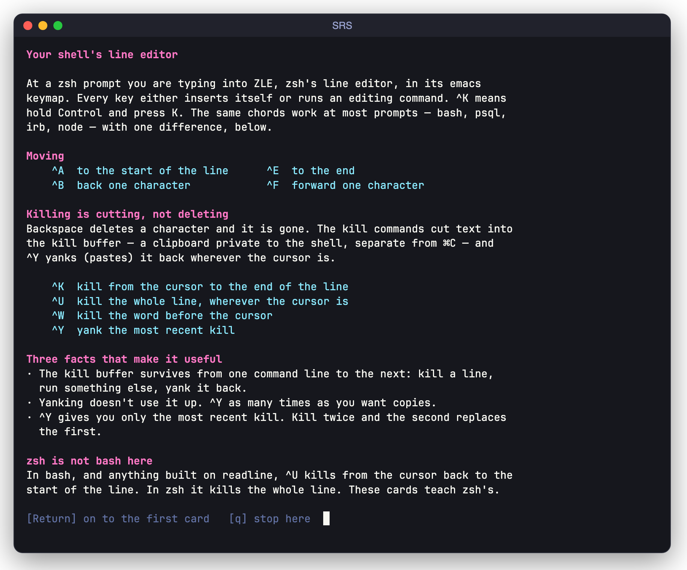 | 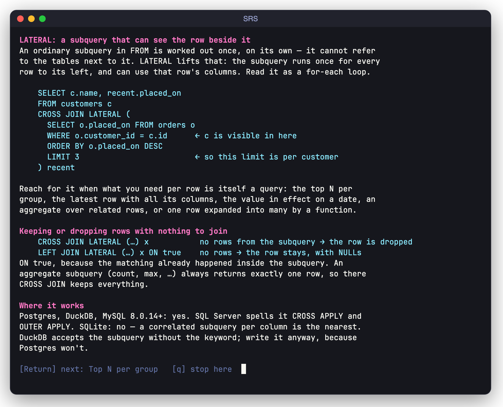 |

Then every card still in the first box — new, or just missed — is preceded by
its **lesson**: the idea and an annotated example, then a rehearsal. A
terminal card's rehearsal is a fresh line in real zsh with the exact keys to
press, ungraded, until you've done it. A lateral card's is a worked example on
freshly generated data: the tables, the formatted query, what it returns, and
why. On a lateral card, `l` brings the lesson back mid-attempt.

| A lesson and its rehearsal | A worked example |
|---|---|
| 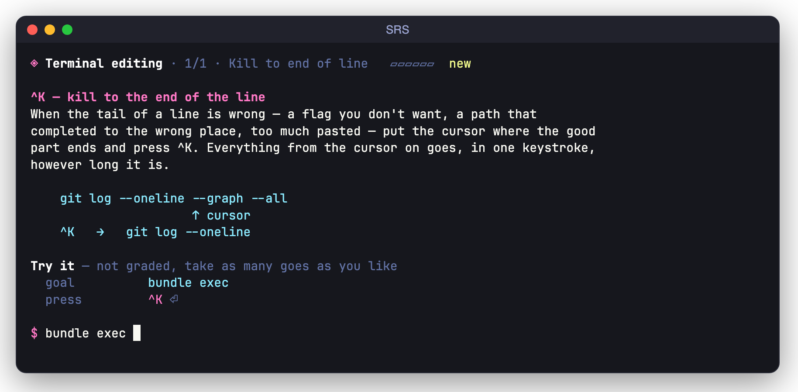 | 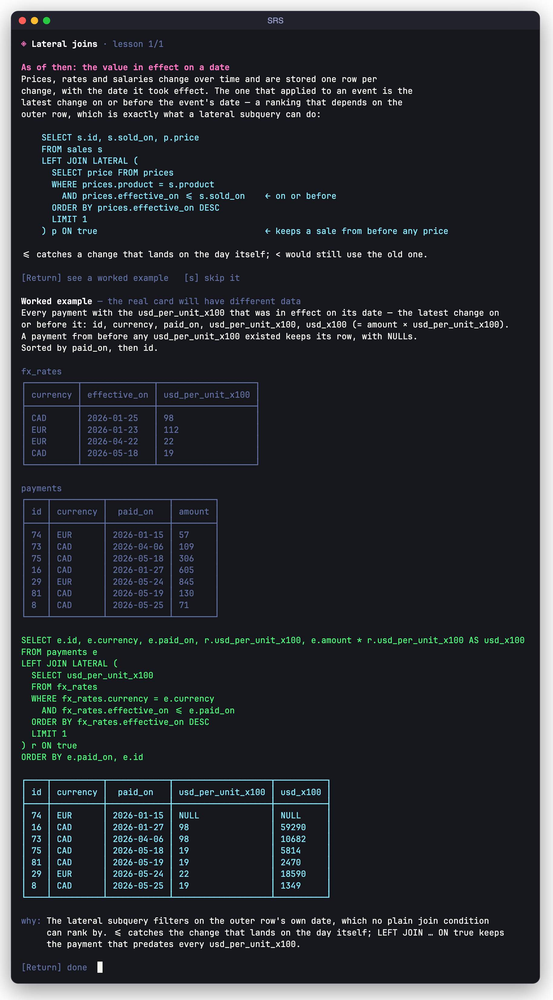 |

New material arrives one card at a time: a session brings reviews first and at
most one card you haven't seen. `srs learn keys` (or **Learn** in a module's
menu) walks through the primer and every lesson whenever you want, ungraded.

## Progress

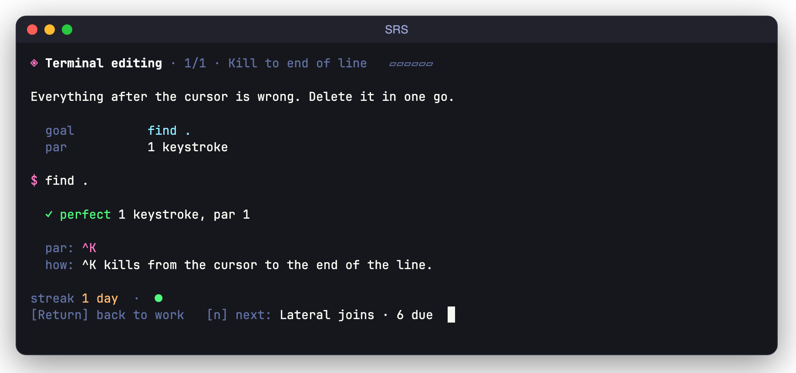

Per card template, in Leitner boxes:

- **perfect** (par keystrokes, or a correct query first try) — up a box; next
  review a few hours later the same day, then tomorrow, in about 3 days, a
  week, then two weeks
- **right the long way** — stays in its box, back sooner
- **miss** — back to the first box, again in ten minutes

Popups only come when a card is due, so they thin out by themselves as cards
climb: several a day for new material, every day or two at first, then a
couple of times a week, weekly, fortnightly. Intervals of a day or more are
jittered ±10% so cards learned together drift apart.

A perfect answer from the last box graduates the card; a module graduates when
all of its cards have, and stops popping up. The daily streak counts days with
at least one card answered. **Practice** in a module's menu quizzes any card
without touching its box.

## Focus mode

macOS has no API that reports the current Focus, and its own database is behind
Full Disk Access. The one thing that sees every Focus — manual, scheduled or
started by an automation — is the Shortcuts action **Get Current Focus**. Create
it once:

1. Shortcuts → New Shortcut, name it **SRS Focus**
2. Add the action **Get Current Focus**
3. Save

Until it exists, popups stay held and the menu says why; **Quiz me now** still
works. Click the **Focus** row in the menu to re-check.

A popup asks before it starts — and anything you were mid-way through typing
when it took the keyboard is thrown away, so a stray Return can't begin a quiz:

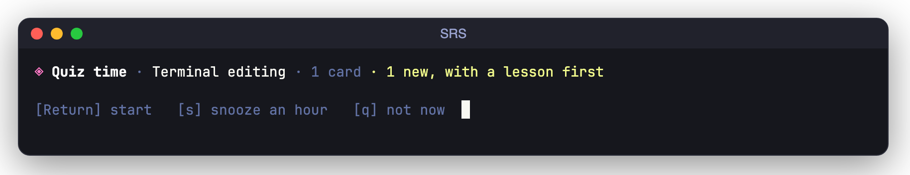

## Use

```sh
srs status            # streak, due counts, a meter per card
srs run keys          # quiz now (or: srs run lateral, srs run --practice keys)
srs learn lateral     # the primer and every lesson; srs learn lateral as-of for one
srs snooze 90         # hold popups for 90 minutes
```

The menu bar item (`hammerspoon/lua/srs.lua`) has the same, plus popup
frequency — every hour or so, every few hours (default), twice a day, or
never — and **Only during the work week** (on by default: Mon–Fri, 9:00–18:00).

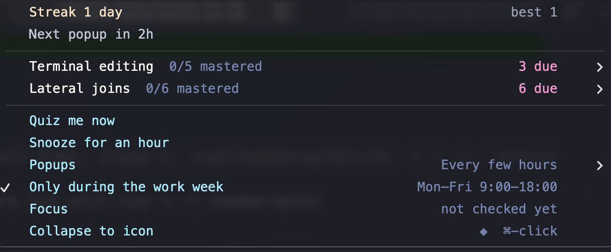

Each module's row opens a submenu with a meter per card, **Learn**, **Quiz
now**, **Practice**, pause and reset.

## Install

```sh
brew install duckdb
./install.sh          # or ../bootstrap.sh; then reload Hammerspoon
```

State is `~/.local/share/srs/state.json`. Tests drive the real zsh line editor
through a pseudo-terminal and check every SQL wrong answer misses:

```sh
/usr/bin/python3 -m unittest discover srs/test
```
